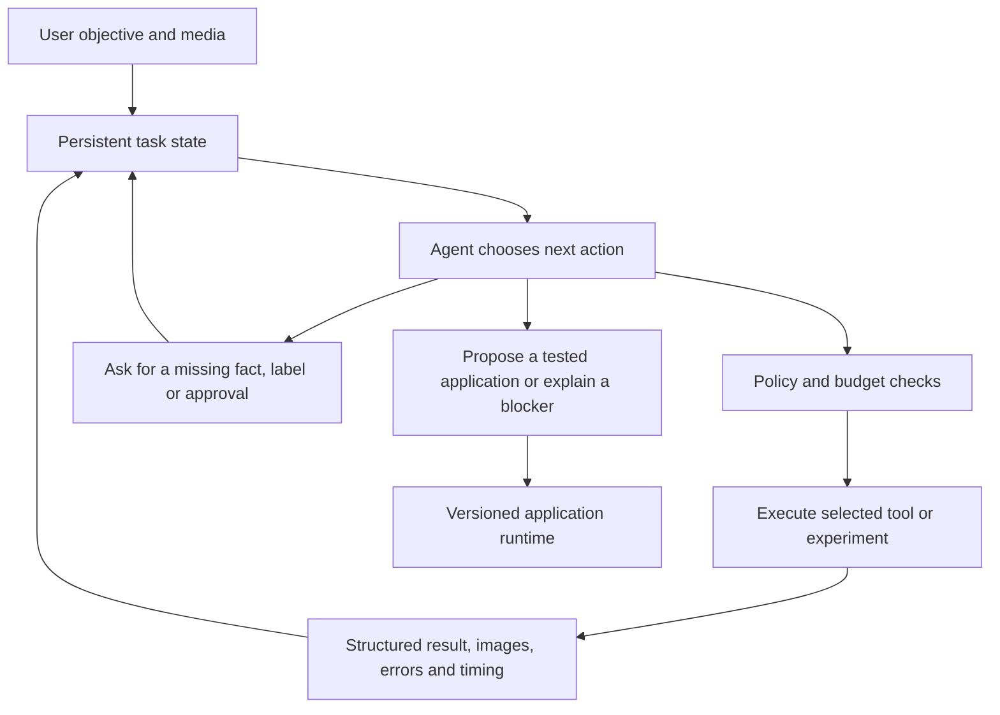

# VisionApp: an agent that figures out how to build the application

29 October 2026 · Revised proposal following the user's product clarification

## Product intent

The user supplies an objective and relevant media. The agent has access to models and other tools. It investigates the task, decides which capabilities to use, conducts experiments, composes an application, examines what happened, and changes its approach until it has a defensible result or a concrete blocker.

OCR, detection, segmentation and visual reasoning are tool capabilities. A fixed OCR or counting workflow is one possible outcome of reasoning, not the organizing principle of the product. Example tasks belong in tests and demonstrations; they must not become a growing catalogue of hard-coded routes.

My previous proposal incorrectly narrowed the product into two workflow families. That framing and its eight-week estimate are superseded. The reusable execution, annotation, persistence and evaluation work remains valuable. The central missing work is an agent runtime that can use those capabilities adaptively.

## What the current code actually does

This is a source review of the checkout, including active uncommitted graph-authoring work. No new execution benchmark was run. The committed baseline was `af3d9e3`; working source may continue changing.

1. In [`agent/planner.py`](../agent/planner.py), host Python calls `blocks_list`, `dataset_context` and `planning_options`, constructs context, and asks the model for a `GraphPlanDecision`. The model instance in this path has a structured output validator, but no registered exploratory business tools. MCP transport exists; the host chooses this sequence of calls.
2. The output is a complete graph or clarification. Validation retries can correct invalid output. They do not constitute an experiment loop driven by the results of actual vision inference.
3. [`agent/executor.py`](../agent/executor.py) then validates and previews saved candidates. These results are recorded and shown, but are not fed back into the same planning loop for the model to diagnose and redesign the application.
4. [`engine/builds/manager.py`](../engine/builds/manager.py) drives planning, labeling, evaluation, approval and improvement through coded branches. A failed metric leads to a prescribed training offer or a request for reviewed examples.
5. [`agent/build_orchestrator.py`](../agent/build_orchestrator.py) chooses candidates by an explicit scalar-score rule. Its `improve` action calls training and then reevaluates. It does not ask an agent to identify the failure and choose between different experiments.
6. The active graph schema in [`spec/authoring.py`](../spec/authoring.py) permits static crop/resize, detection/counting and readers. The current prompt explicitly excludes detector-driven crops and VLM authoring. The planning model contract in [`spec/planning.py`](../spec/planning.py) exposes three task types and two output-contract families. This is narrower than the underlying product ambition.

There are three distinct maturity levels:

| Level | Behavior | Current position |
| --- | --- | --- |
| Template selection | Choose a workflow family and fill parameters. | Earlier implementation; legacy decisions remain readable. |
| Graph generation | Produce a new arrangement of supported nodes from the request. | Active implementation work. Important, but incomplete agent behavior. |
| Adaptive application building | Inspect input, discover tools, run probes, assess results, revise strategy/graph, test and package. | The target; the core closed loop is missing from the inspected build path. |

The main gap is between graph generation and adaptive application building. Adding more models or graph node variants alone will not close it.

## The intended agent loop

The agent chooses the next useful action. The host validates arguments, permissions, resource limits and data boundaries; it executes the action and returns an observation. This division lets the host remain deterministic without prescribing the problem-solving strategy.

A short initial plan is provisional. The agent may discover that its assumptions are wrong and revise it. Each experiment uses a saved plan revision; earlier results remain intact. The final application has its own runtime behavior and does not require the builder agent to reconsider every frame. If a VLM is part of that application, it is an explicitly configured runtime component.

Use the existing agent library if it can support this loop. Native tool calling is one implementation option; a typed next-action response that the host executes and feeds back is another. The essential property is that the model chooses subsequent actions from actual observations. No new framework is required merely to achieve that.

## The capabilities that must be built

| Workstream | Required behavior | Why the present system is insufficient |
| --- | --- | --- |
| **Task understanding and persistent state** | Maintain objective, constraints, deliverables, assumptions, questions, hypotheses, experiments and selected artifacts. Distinguish what the user asked from what the agent inferred. | Dataset statistics and one graph decision do not represent an investigation. |
| **Tool discovery** | Search/list capabilities, inspect one tool's schema, supported hardware, inputs/outputs, limits, readiness and provenance when needed. | Injecting the entire catalogue into every prompt creates context pressure and does not let the agent discover details selectively. |
| **Media inspection** | Select representative development frames, inspect images/crops and obtain visual descriptions through a vision model when needed. | The inspected planning path supplies metadata, not an interactive visual investigation of the actual sample. A text planner can use a vision model as a tool. |
| **Experimental inference** | Invoke an eligible model on a chosen image/crop/clip without first committing a whole application. Receive observations, overlays, confidence, timing and errors. | Current preview is mainly a post-plan execution step. Tools should support provisional experiments. |
| **Result-driven reasoning** | Inspect poor results, form a testable hypothesis, choose a change and compare its effect. | Schema retries and fixed training offers do not diagnose vision failures. |
| **Compositional execution** | Connect tools through data-dependent operations: detect → crop each object → inspect/read → associate → aggregate → decide. Support conditional branches, joins and bounded iteration. | Static crop and one detector/count aggregate cannot express common multi-stage tasks. Object identity and coordinates must survive composition. |
| **Application construction** | Create and edit a workflow plus source contract, result schema, application view, event logic and run settings. | A graph is only part of a usable app. Build reusable UI components from a typed presentation specification. |
| **Testing and evaluation** | Choose relevant development tests, inspect failures, compare alternatives, request specific annotations and use trusted metrics. | One scalar score cannot establish all output requirements, relationships or temporal behavior. The agent must not invent its own passing evidence. |
| **Memory and recovery** | Persist explored approaches, measurements, artifact references, unresolved questions and the next checkpoint. Resume without repeating effects. | Durable traces are a useful base; the agent also needs compact decision-relevant state. |
| **Termination and handoff** | Recognize sufficient evidence, inability to solve, absent capability and diminishing returns. Deliver an application version or a specific blocker. | An open-ended loop without stop rules can spend indefinitely or claim completion too early. |

Visual inspection and model-generated explanations remain hypotheses. When judging correctness matters, reviewed labels or another defensible reference are required. The agent can select development tests; it cannot manufacture ground truth or rewrite acceptance thresholds after seeing its results.

## Tool and artifact design

Build on the existing MCP boundary and common inference evidence. The following tool groups describe proposed contracts, not capabilities already delivered:

- **Discover:** search capabilities; inspect one schema; check readiness; propose installation when needed.
- **Inspect:** describe media inventory; sample eligible frames; view an image/crop; invoke a visual reasoning model; inspect prior results.
- **Experiment:** run a selected capability with bounded inputs; profile it; compare two captured outputs; extract failure examples.
- **Construct:** create/edit/validate a workflow; create its result and UI specifications; preview a selected version.
- **Evaluate:** inspect available labels; request targeted review; run task/branch/relationship metrics; inspect errors.
- **Improve:** change a model, prompt, threshold, transform, routing or resolution; propose training when its expected benefit justifies it.
- **Deliver:** save a version and report; request the existing approval for recorded operation or external effects.

Do not collapse all vision operations into one untyped “run anything” function. Shared tools can dispatch through versioned capability-specific schemas. Each model/tool descriptor should expose useful semantics, parameter schema, input/output types, constraints, resource requirements, execution location and provenance. Model details should be loaded on demand.

Observations should include artifact references, structured values, original/crop coordinates, object association, source time, timing and explicit failures. Images/overlays can be returned to a multimodal planner or examined by an available vision tool. A successful API call, a positive detection and a correct task result are distinct observations.

Persistent objects can extend existing contracts: `TaskState`, `Experiment`, `Observation`, `WorkflowRevision`, `EvaluationReport` and `ApplicationVersion`. Store concise decision summaries and evidence references. Fetch detailed history when needed instead of carrying all images, catalogues and logs in every prompt.

## General composition is a material engine change

The agent needs enough building blocks to implement a strategy it discovers. The next graph extensions should therefore address expressiveness:

1. A detection produces an identified collection of objects, each linked to its source frame and geometry.
2. A crop operation can accept those objects and produce a bounded collection of crops with mappings back to the source.
3. A reader or visual model can operate on each crop; its outputs retain the parent object identity.
4. Branches can join on identity or a declared spatial relationship, rather than concatenating all strings or detections.
5. Typed predicates, aggregation and conditions can transform those results into application outputs.
6. Temporal operators later preserve identity across frames and make event episodes explicit.

These primitives unlock many tasks without adding a named business template. They require real runtime, schema, UI and evaluation work. A planner prompt cannot compensate for missing data types or operators.

Start with the typed workflow language. If representative unseen tasks repeatedly require logic it cannot express, evaluate a bounded code node or sandboxed application-building environment as a deliberate architecture extension. Arbitrary code generation is not an implicit requirement of being agentic, and it would bring separate packaging, execution and testing responsibilities.

## Example of the desired reasoning behavior

Suppose the user asks: “Inspect these incoming cartons and report discrepancies against the shipment list.” This is an illustrative future task, not a current capability claim.

The agent should determine what “discrepancy” means, inspect the supplied media and reference data, discover available models/tools, and test plausible ways to locate cartons and identify their contents or labels. It might find that whole-image reading mixes labels from different cartons, then choose object detection → per-object crop → reading → association with the supplied list. If carton localization is weak, it could try a different eligible model or request examples that resolve the ambiguity. If a necessary reference-data parser or association operation is missing, it should identify that specific capability gap.

The system should not contain an `incoming_carton_discrepancy_template`. The application should emerge from available primitives and observed results. Nor should it require every task to use detection first: for a close-up image, direct reading might be adequate. The agent should earn that choice through the input and experiment results.

## Revised milestones: measure increasing agent capability

| Milestone | Deliverable | Exit test |
| --- | --- | --- |
| **A0 — Agent architecture spike** | Connect a model to a small tool set and an observation loop; persist state, budget and artifacts. Reuse existing execution infrastructure. | In one real session the model chooses an experiment, receives its actual result and changes its next action. The changed action is not hard-coded in the host. |
| **A1 — Media-aware investigation** | On-demand capability discovery, frame/crop inspection, provisional model calls and hypothesis/experiment records. | On unfamiliar media, the agent selects what to inspect and which eligible tool to try; its choice changes when the evidence changes. |
| **A2 — Compositional application synthesis** | Data-dependent crops, per-object operations, associations, branches and result/UI specifications. | Build multiple previously unseen combinations of existing primitives without adding a task route, template or prompt exception. |
| **A3 — Diagnose and improve** | Failure inspection, targeted labeling requests, model/transform/strategy changes and bounded comparisons. | A flawed first attempt leads to an evidence-based revision. The agent can distinguish an execution defect, poor vision quality and missing capability. |
| **A4 — Persistent application builder** | Resume investigations, refine existing applications, version outputs and run saved versions on new data. | Restart and user edits preserve relevant state; final applications run without the build agent controlling every ordinary step. |
| **A5 — Generalization and release** | Frozen unseen-task benchmark, resource/usability checks, clean setup and packaged handoff. | Success generalizes across task wording, media and tool combinations; no task-specific host-code additions are made for the test set. |

A0 is the immediate next development milestone. Existing graph-authoring work supplies useful pieces for A2; it should not be represented as completion of A0–A3. Installation, packaging and independent quality checks remain cross-cutting work, but they do not substitute for these capability milestones.

Time-box the A0 architecture spike to five working days with a named agent/backend owner and support from the vision/runtime owner. This is a proposed investigation budget, not a promise of completion. Its outputs are a runnable loop, one positive real trace, a retained failure trace, latency/context observations and a work estimate for A1–A3. Replace the earlier full-release schedule only after this evidence exists; the previous estimate omitted major agent/runtime work.

Requalify the planner model for this workload. Existing graph-output benchmarks do not establish multi-step tool selection, visual-result interpretation or recovery. Measure end-to-end task time, context growth, repeated model loading and detector/VLM coexistence. A sequence of individually slow calls can make a correct agent unusable. Test local candidates against the same loop; if local capability or latency remains insufficient, present that evidence before deciding whether to change the local-only execution requirement.

## How to test whether we actually built an agent

Keep authored tests for invariants, but evaluate the product on tasks held out from prompt and template development. Organize the suite by reasoning demands—tool choice, decomposition, data-dependent composition, revision after failure, clarification, missing capabilities and stopping—rather than named customer workflows.

Compare the fixed-pattern baseline, the current graph generator and the new adaptive loop with the same tools, media, time budget and task criteria. Score task completion, constraint preservation, artifact correctness, useful revisions, unnecessary calls, intervention count and latency. Successful adaptive recovery must show a relevant observation before a strategy change. Random extra calls are not evidence of reasoning.

Include counterfactual pairs: the same request with images needing different approaches; the same image with different required outputs; a tool unavailable in one run; a model that executes but produces poor results; a task that cannot be solved from the supplied pixels. Test fresh combinations and paraphrases without changing the host code. Introduce one compatible new tool through its descriptor/adapter and check that the planner can discover and use it without a new task router.

Separate development exploration from final quality acceptance. The loop may inspect and tune against development data. Independent acceptance remains protected and human-authorized at the appropriate checkpoint. A failed final test does not justify repeatedly tuning against that same held-out set.

## Engineering decision and next work

Preserve the compiler, MCP transport, model adapters, execution receipts, labels, packaging and approval enforcement. Change the ownership of problem-solving decisions: a persistent agent chooses experiments and revisions; the host authorizes and executes them. Replace task-specific improvement branches with general actions and evidence, while keeping deterministic safety and correctness invariants.

The next implementation proposal should be for A0: explicit tool schemas, the model-visible observation format, task state, action loop, stop conditions and one end-to-end acceptance trace. It should name what is reused and which current host-controlled branches it bypasses or replaces. This is the missing foundation on which a broad vision-app builder can grow.
