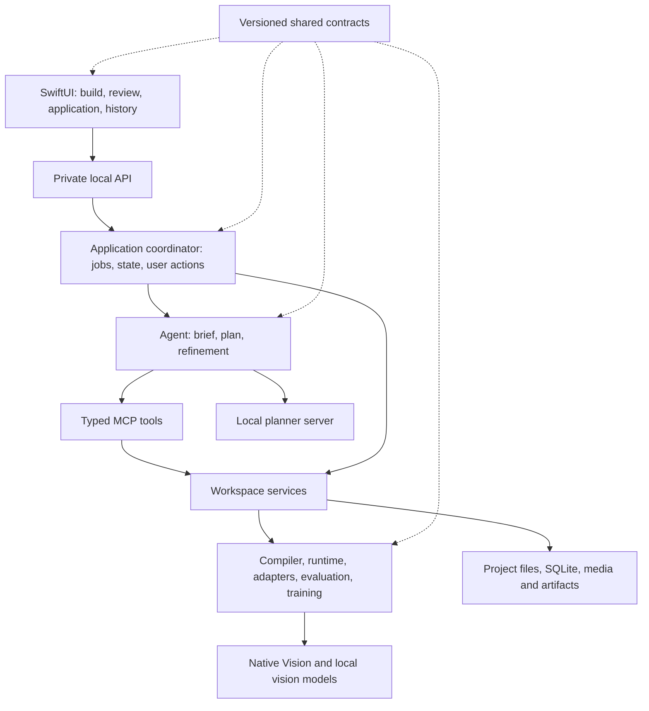

# VisionApp: gap review and revised product proposal

> **Superseded product framing:** The user clarified that the product is an agent that discovers and uses model tools to figure out how to build an application. Organizing the release around counting and reading workflow families below constrains that intent. Use [the agent architecture revision](agent-builder-proposal-2026-10-29.md) for the product direction, core gap and milestone sequence. Retain this document as a record of operational/evaluation considerations; its family-based scope and delivery estimate are not the accepted roadmap.

Prepared 29 October 2026 · Proposed scope and sequencing for review

This proposal reviews the original build plan, current source, implementation notes and saved verification artifacts. The committed baseline inspected was `af3d9e3677fa8b590157d745c9311b279d28b144`. The checkout also contained active, uncommitted composition/refinement changes. Evidence for an earlier source identity is not treated as a pass for that working tree. This review did not rerun models, tests or the installed app.

## 1. Recommendation

Build a local vision application builder for people who can explain an inspection task but cannot implement a vision pipeline. Keep the conversation, generated application and observed results together. Deliver the first supported release around two workflow families: **detect/count within a region** and **read/check a label or barcode**. Demonstrate that the same builder handles both, with task-specific evaluation. Maintain damage inspection as an explicitly experimental path until its defect definitions and representative data support a separate acceptance decision.

The first customers to validate are internal solution engineers and technically comfortable operations analysts. This is a proposed initial audience; no customer demand study or commercial commitment is established by this repository. Their job is to turn a prospect's sample media into a reproducible application, explain where it works, and hand off the application and its evidence.

The product promise should be: **Describe a supported visual task, test the resulting application on your media, improve it with corrections, and run a saved version with inspectable results.** Unsupported requests must produce a specific missing capability or missing evidence request.

Success has three independent dimensions: the agent builds what was requested; the vision workflow meets its task's quality target; and the application runs reliably on supported hardware. A pass on one dimension does not imply the other two.

## 2. Problems in the existing plan

| Gap | Evidence and consequence | Proposed correction |
| --- | --- | --- |
| Product breadth is confused with pilot accuracy | The original MVP promises pallet counting, damage inspection and reading. These need different labels, models and evaluation. My earlier response then reduced the roadmap to a counting demo. | Preserve the builder; use two bounded workflow families to validate it. Give each task a quality scorecard and supported scope. |
| The original milestone detail is missing | The source contains an embedded-content placeholder where the five phases should be. The 13-week estimate has no recoverable work breakdown. | Replace it with named deliverables, dependencies, owners and exit evidence. Re-estimate after one integration milestone. |
| Original model and block tables overstate executable scope | The actual registry contains 13 block types. Tracking, tiling, segmentation and arbitrary classification are absent. YOLOX is integrated on CPU; several other proposed families are absent. | Generate capability status from the registry and receipts. Schedule capability additions against a measured user need. [S2] |
| Authoring breadth exceeds proven planner behavior | Crop/resize blocks exist, but the committed planner used fixed patterns. Composition is active work. The retained composition attempt at source `f910cda…` failed its context budget before a model response. | Finish composition and context budgeting together; require actual planner, compiler, preview and native evidence at one frozen source. This retained failure does not prove later edits still fail. [S3] |
| Evaluation cannot qualify everything a graph can execute | One numeric gate and aggregate text outputs cannot separately establish OCR, barcode and detection quality. Text regions are editable, but spatial scoring remains open. | Introduce explicit output requirements and per-output evidence; keep mixed workflows exploratory until their required outputs are scored. [S4] |
| Video counting has ambiguous business meaning | Current counts are detections per sampled frame/region. Evidence queries count observation rows; they use persistence time. Live playback drops busy frames. | Distinguish occupancy, unique flow and event episodes. Carry source time and processing time explicitly. Promise exhaustive offline analysis only after a separate scheduler is verified. [S5] |
| A working project is not yet a defined handoff product | Plans, projects and deployment records exist; a complete portable application release with dependency recovery and rollback is not established by the inspected evidence. | Define a versioned application manifest, readable run view, portable report and tested restore/rollback flow. |
| First-run model setup remains a product gap | The app bundles Python, not planner weights or a fully configured model server. One unified detector install recipe exists. | Include model/runtime setup, download sizes, hardware compatibility and a real first-run inference test in onboarding. [S6] |
| Planner latency and reliability lack release targets | Historical suites recorded 24/25 initial and 19/24 refinement cases; later focused fixes do not constitute a fresh full-suite pass. A reference M4 Pro/48 GiB is already documented. | Reuse that hardware as the initial engineering target, rerun a frozen suite, report cold/warm latency and context-limit failures. Do not reopen hardware selection unnecessarily. [S7] |
| Architecture descriptions have drifted | The original says engine never imports agent. Current build, state and platform coordination modules do. This is not itself proof of a runtime defect. | Document the application coordination layer separately from the CV core. Move shared policy/contracts where useful, without a broad rewrite. [S8] |
| Status documents contradict each other | The platform revision predates catalog, playbooks and YOLOX work; the remaining-work paragraph still says text-region editing is absent after the latest checkpoint added it. | Maintain one concise current capability ledger with commit, artifact, scope and limitation; retain older documents as dated history. [S1] |
| Release and commercial claims are underdefined | Ad-hoc packaging works; full release checks, operating support, transferability and product validation remain incomplete. | Separate internal builder alpha, operational beta and later enterprise scope. Use user/task evidence before asserting business value. |

## 3. What exists today

Status here means repository/evidence status, not an assertion about the currently running app. **Verified slice** means a saved receipt supports the named behavior. **Partial** means implementation exists with material incomplete acceptance. **Active work** means uncommitted source was present. **Planned** means not established as delivered.

| Capability | Status | Current boundary |
| --- | --- | --- |
| Native goal composer and conversation beside preview | Verified slice | Real describe-to-OCR and detector preview paths were exercised; general brief reliability remains incomplete. |
| Typed workflow compilation | Verified slice | Checks graph references, ports, cycles, params and supported models; only registered blocks execute. |
| Saved plans, execution events and replay | Verified slice | Immutable plan revisions, actual tool evidence, stale-input checks and captured-result replay. |
| Capability catalog and playbooks | Verified slice | Installed/available/unsupported catalog; six bundled versioned playbooks. A tracking/segmentation playbook does not supply an adapter. |
| Composed graph generation | Active work | Per-block model binding, crop/resize and parallel readers; complete current-source live/native acceptance is not established in this review. |
| Natural-language refinement | Partial + active work | Existing typed edits and preview-before-commit; preprocessing refinements and richer comparison behavior are under development. |
| Object/zone annotations | Verified slice | Draw/edit, review, autosave, zones, COCO transfer and snapshots. |
| Text-region annotations | Verified slice | Four corners, transcripts, undo/redo and complete-label transfer; localization scoring remains open. |
| Model provisioning | Partial | Reviewed YOLOX-s ONNX recipe with hashes, installation and smoke evidence; broader recipes and first-run planner setup need work. |
| Detection | Partial | OWLv2, RT-DETRv2 and YOLOX execution; fixed-class vocabulary limits apply. No accepted warehouse quality claim. |
| OCR and barcode | Partial | Actual Apple Vision output/geometry; a public cropped-word diagnostic does not establish warehouse-label quality. Alternative OCR remains a probe. |
| Local VLM judgement | Experimental | Crop judgement can run; confidence is a model estimate. No accepted damage-inspection result. |
| Candidate comparison and acceptance | Verified software, incomplete task evidence | Frozen protocols, reviewed labels, reserved acceptance and stale-evidence rejection. Representative quality gates remain open. |
| Local detector training | Partial | RT-DETRv2 forward/backward/save/reload and reviewed-data flow exercised. Useful improvement is task dependent. |
| Recorded media and live ingress | Partial | Bounded file processing and actual timestamp-paced native playback. Camera/screen hardware permission flows need validation. |
| Events, evidence questions and alerts | Partial | Local records, bounded queries, Keychain and protocol transport checks. Observation/time semantics and event-quality acceptance limit product claims. |
| Packaging and release | Partial | Relocatable runtime and local signing verified. Clean-user setup, migration, support and distribution acceptance remain open. |

The latest text-region checkpoint reports 848 base tests with two optional skips, 242 native checks per build configuration, and a saved installed walkthrough. Those counts apply to its source identity, not to the moving composition branch. Historical detector and reading benchmarks have failed or remain diagnostic; none is silently promoted here. [S1]

## 4. Define the application the user receives

The generated deliverable is a saved application inside VisionApp. It has a name, input source contract, output view, workflow revision, required capabilities, evaluation scope and run history. The initial release does not require generating arbitrary Swift code or a separate executable for each app.

The primary interaction has four views:

1. **Build:** conversation, live activity, actual preview, assumptions and one clear next action. Advanced graph details are expandable.
2. **Review and compare:** exact-image corrections, failures first, per-output candidate results, and a concise explanation of the next improvement.
3. **Application:** select new input, see supported scope and saved version, run/stop, inspect outputs and export results.
4. **History:** prior runs, versions, evidence, changes and restore actions. Evidence questions link to matching records and state their time basis.

Setup appears when a capability is missing. The UI should say what needs installation, approximately how much space it needs, why it is needed, and what happens after installation. A user should not have to configure Python or infer a model alias from a failed request.

Use separate visible statuses for **execution readiness** (missing capability, ready, interrupted), **quality** (unmeasured, failed, accepted for stated scope), and **operation** (preview, local trial, approved recording). Combining them into one green “ready” badge would obscure what was established.

Example A: “Count people inside this region in these images.” The app requests region geometry if missing, runs an eligible detector, shows per-image occupancy counts, requests corrections and evaluates count error. It does not turn repeated appearances into unique people.

Example B: “Read the text in the left half, compare it exactly with ABC-990, and show match or mismatch.” The app composes crop → OCR → comparison, displays the literal observed text and mismatch, and creates no event unless requested. Its quality report scores reading and the decision separately once comparison evaluation is implemented.

Example C: “Read the text and barcode on each label.” Both outputs must remain visible and attributable to their reader. A mixed result may be useful as a preview before both branches have adequate evaluation; the interface must show that distinction.

## 5. Detailed feature backlog

P0 is required for the builder alpha. P1 is for the operational beta or a gated extension. P2 is later work. Each row specifies a deliverable, rather than a model name alone.

| ID / priority | Deliverable | Implementation work | Acceptance evidence |
| --- | --- | --- | --- |
| F01 P0 | Supported-task brief | Extend existing TaskBrief/plan contracts with output meanings, source/time basis, count mode, literals, assumptions and missing inputs. | Literal values and requested behavior survive planning/refinement; no invented zones or thresholds. |
| F02 P0 | Composed authoring | Complete typed node generation, per-block model bindings, context budget and schema/graph validation. | Real planner builds crop/resize, region count and parallel-reader cases; captured graph matches executed preview. |
| F03 P0 | Reliable refinements | Finish preprocessing edits; explicit branch selection; structural edits supported only where implemented; show a readable change summary. | Compound edits are atomic; a failed preview cannot commit half an edit; prior evidence becomes stale. |
| F04 P0 | Usable progress and recovery | Accurate step/status, errors with next action, cancel/interrupt handling, explicit retry and safe reopening. | Model unavailable, timeout and app restart are exercised through the UI without duplicate side effects. |
| F05 P0 | First-run setup | Reference-hardware check, planner/runtime recipe or guided supported setup, detector recipe completion, disk/download readiness. | Fresh user profile reaches actual inference without a terminal; offline operation works after assets are installed. |
| F06 P0 | Media and region setup | Explain sample import versus full clip processing; carry source identity, frame index and timestamp; capture region confirmation. | Counts, overlays and corrections refer to the same source image/time after import and restart. |
| F07 P0 | Targeted corrections | Preserve existing box/text editors; prioritize informative failures and make “return to build” reliable. | A new user corrects an object and text region without losing the build; proposals stay distinct from reviewed labels. |
| F08 P0 | Dataset workflow | Guided scene grouping, train/selection/acceptance assignment and duplicate/exposure checks. | Acceptance sources remain unused by previews/proposals/training; explanations identify the specific blocker. |
| F09 P0 | Detection/count quality | Precision, recall, count MAE, tail count error, zero-object behavior and declared failure slices. | Same-task candidates use the same reviewed selection data; frozen candidate gets independent acceptance. |
| F10 P0 | Reading/check quality | Preserve raw Unicode; score OCR transcription, barcode payload and match decision; add named field/region association where claimed. | Leading zeros, confusables, blanks, missing reads and mismatch decisions score correctly against reviewed labels. |
| F11 P0 | Per-output evaluation | Version an output contract and composite report; identify required outputs and gates; provide localization scoring if spatial text accuracy is claimed. | A correct branch cannot hide a failed branch. An unscored required output blocks whole-application acceptance. |
| F12 P0 | Useful model experiments | Compare at most three eligible candidates under the same task; retain reasons, model identity, latency and failures. | Selection uses measurements; any new adapter earns its place against an existing baseline. |
| F13 P0 | Application versions | Build on existing plans/deployment records: version manifest, capability requirements, result schema, scope and evidence references. | Save, reopen and restore a prior version without silently restoring invalid approval. |
| F14 P0 | Recorded operation and results | Predictable new-media runs, clear sampling coverage, CSV/JSON results and human-readable evidence report. | A second media batch preserves development labels, links every output to its source and exposes skipped/failed inputs. |
| F15 P0 | Time-correct questions | Store/query media time separately from ingest time; name count units and coverage; preserve immutable evidence references. | “At 00:30 in this clip” resolves against clip time; “processed today” resolves against ingest time; unique counts are unsupported until tracked. |
| F16 P0 | Restore and release hygiene | Whole-app/project export design, asset manifests, missing-model recovery, migration checks, dependency inventory and clean-machine checks. | Transfer to a fresh profile, restore labels/history and revalidate capabilities. Credentials and nonredistributable weights are not copied implicitly. |
| F17 P1 | Conditional specialization | Keep bounded training with lineage; request more examples or preprocessing improvements when those address the observed error. | Improvement wins on selection data and is accepted separately; final acceptance is never reused for iterative tuning. |
| F18 P1 | Event episodes and alert quality | Define onset/clear, duration, cooldown, duplicate suppression, time basis and delivery semantics; choose one transport for pilot acceptance. | False alerts/hour, event precision/recall and trigger delay are measured; reconnect/retry does not imply unverified exactly-once delivery. |
| F19 P1 | Camera/screen operation | Permission, device loss, reconnect, stop, bounded retention, frame drops and resource acceptance. | Real hardware scenarios and a declared-duration soak pass; processed coverage is visible. |
| F20 P1 | Complete offline video processing | Add explicit exhaustive sampled-frame mode separate from real-time playback; progress and restart checkpoints. | Every scheduled frame is processed or marked failed; elapsed processing time is not misreported as real-time FPS. |
| F21 P2 | Tracking and unique flow | Track identity, crossings, re-entry and dwell; define occlusion rules and event ground truth. | Unique/flow metrics on annotated sequences; no conversion of frame observations into totals. |
| F22 P2 | Segmentation, tiling and damage | Specific output schema, adapter feasibility, labels, localization metrics and hardware limits for each family. | Each extension has an independent task benchmark and a supported user workflow. |
| F23 P2 | External research and integrations | Optional source acquisition with provenance; later remote compute, RTSP fleet and WMS/event-system interfaces. | A named user task and concrete integration contract justify each addition. No customer integration is assumed. |

For alpha, F11 must at least qualify the promised count and reading/check applications. Parallel OCR/barcode can remain preview-only if separate ground truth and per-branch evaluation are incomplete; that limitation must be explicit in release scope. This is a scope reduction decision, not a blanket acceptance of mixed graphs.

## 6. Architecture to support the plan

Keep the existing native/Python system. Avoid a rewrite or a proliferation of services.

The coordinator is already substantially represented by `engine/builds`, API routes, state and platform modules. Document this ownership explicitly. The reusable CV core should remain independent of agent policy. Shared phase/authority contracts currently imported from `agent` can migrate incrementally into neutral contracts when a feature touches them. Do not start with a module-moving exercise.

| Current area | Owns now / intended extension |
| --- | --- |
| `spec/` | Pipeline, plan, capability, annotations and evidence contracts; add/extend output requirements, media-time semantics and application manifest. |
| `agent/` | Local planner calls, semantic fidelity, graph/refinement decisions and playbook selection; never grants approval. |
| `mcp_server/` | Typed service access; business rules continue in engine services. |
| `engine/builds`, `engine/api`, state/platform modules | Application orchestration, durable operations, conflict handling and user-authorized actions. |
| `engine/compiler`, `runtime`, `blocks`, `adapters`, `models` | Executable graph and inference contracts; record input/output identity, coordinates and time. |
| `engine/eval`, `train`, datasets/annotations | Reviewed labels, split/exposure policy, per-output measurements and model lineage. |
| `engine/store`, `alerts`, `live` | Runs, observations, event episodes, delivery attempts, capture and retention. |
| `app/` | Native user journey, capture/permissions, Apple Vision, progress and correction tools. |

Extend existing records instead of creating a parallel source of truth. The proposed application manifest references an existing immutable plan/candidate, model fingerprints, annotation/evaluation protocol versions, supported scope and required output gates. An operating run references that manifest plus its actual input. Observations gain explicit `source_id`, `source_time`/frame index and `processed_at`; event episodes and delivery attempts are separate records. Historic reports retain their original interpretation; migrations never fabricate timestamps or quality evidence.

Model installation, successful execution and task suitability remain distinct. Training cannot be the default response to every failure: first identify missing objects, resolution, crop/zone mistakes, unreadable text, distribution shift or incompatible classes. The improvement proposal should name the error it expects to reduce and the bounded experiment that will test it.

## 7. Delivery sequence and staffing

Planning assumption: three available engineers—agent/backend (A), vision/evaluation (V), native/integration (N)—plus a named product/domain reviewer (P) and access to an independent tester (Q). This is a staffing proposal, not a claim that these people are allocated. Annotation effort and distribution credentials are separate dependencies. With fewer engineers, preserve milestone order and revise dates.

Use the documented Apple M4 Pro/48 GiB as the first reference configuration. A broader minimum hardware claim requires additional measurements. Retain local inference as the initial execution contract; remote GPUs and data transfer require a separate product decision.

| Milestone / planning window | Deliverable and owner | Depends on | Exit evidence |
| --- | --- | --- | --- |
| M0 — Baseline and release scope; week 1 | Freeze the active implementation, resolve documentation contradictions, publish capability ledger and two task contracts. A + V + N; P decides scope. | Access to current work, public/consented media and reference Mac. | One source/binary/evidence manifest; supported/experimental/unavailable list; dataset sourcing and annotation owner. |
| M1 — Reliable builder; weeks 2–3 | F01–F04 and composed-graph native journey. A + N. | M0, current composition branch integrated. | Frozen real-model semantic suite, crop/count/reading native walkthroughs, exact request preservation and timeout/recovery results. |
| M2 — Task evaluation; weeks 2–5 in parallel | F06–F12, task datasets and output-specific scoring. V leads, A supports. | M0 task definitions; reviewed data; M1 outputs for final integration. | Count and reading/check scorecards; mixed output limitations enforced; independent acceptance reserved. |
| M3 — Usable saved applications; weeks 4–6 | F05 and F13–F16: setup, versions, run view, results, time semantics and transfer. N + A, V supplies model recipes. | M1; M2 result schemas frozen early. | Fresh-profile setup; new-media run; restore/rollback; source-linked export and query behavior. |
| M4 — Builder alpha decision; weeks 7–8 | Integrated native acceptance, pilot task quality, user walkthroughs and release evidence. All; P accepts scope; Q independently tests. | M1–M3. | Demonstrated supported tasks, no unscored required output, stated operating envelope and release-blocker review. |
| Contingency; weeks 9–10 | Address measured planner, quality, packaging or usability failures. | Actual M4 results. | Retest only changed or affected scope; revise scope explicitly if target is not met. |
| M5 — Operational beta; additional 4–6 weeks after alpha | F18–F20, one verified live-source path, event episodes, one alert transport and sustained operation. N + A + V. | Alpha, event labels, hardware and agreed latency/false-alarm targets. | Event-quality scorecard, permission/reconnect/soak evidence and controlled distribution checks. |

These are rough planning ranges, not delivery commitments. Eight weeks is the integration target; ten includes initial contingency. Annotation access, compound evaluation and planner context/latency are the largest unknowns. Re-estimate after M0 and after M1; do not add every P1/P2 item inside the alpha estimate.

The critical path is: supported task contracts → reliable output semantics → scoring/ground truth → selected-candidate acceptance → packaged user acceptance. Model setup and release packaging run in parallel from the start. Failure of an independent accuracy gate can still leave a useful experimental builder, but it removes the corresponding accepted-task claim from the release.

## 8. Acceptance and measurement

The following targets are proposed engineering gates. They are not current results or assumed customer requirements. P and V should agree the task targets in M0 before tuning.

| Dimension | Proposed gate and method |
| --- | --- |
| Agent task fidelity | Frozen suite: 40 initial briefs, 40 refinements, 20 evidence questions across supported, ambiguous and unsupported cases. At least 95% supported-case success; all designated critical literal/event/source preservation cases pass. Publish denominators and failures separately. |
| Breadth | Real native journeys for region counting, OCR/check, barcode reading and composition preview. A new wording or media batch must not require developer edits. |
| Initial response | UI acknowledges an action within 1 second. On the reference Mac, target warm first preview p95 ≤90 seconds for five defined test images; report cold start/model load separately. Investigate p95 >180 seconds before alpha. |
| Refinement | Target p95 ≤45 seconds on the frozen workload, including preview. Timeout rates and failed cases count in reliability reporting, not discarded latency samples. |
| Counting task | Starting target: reviewed per-frame count MAE ≤0.5 and absolute error ≤1 on ≥90% of tested frames; report detection precision/recall, empty-scene false positives and each required scene slice. These targets may be changed in M0 to match the actual use. |
| Reading/check task | Starting target: ≥95% exact required-field/payload accuracy on declared readable conditions; report missing reads, CER/WER, comparison confusion matrix and raw Unicode errors separately. Localization claims need their own geometry metric. |
| False acceptance | Choose tolerable false-match risk with the task owner and size negative/mismatch tests accordingly. A small sample with zero false matches is insufficient evidence of a rare-error guarantee. |
| Multi-output app | Every required output meets its own gate and composite decision is tested. Correct OCR cannot compensate for failed barcode or detection. |
| Video operation | Report input duration, scheduled/processed/skipped/failed frames, timestamps, resolution, processing speed and resource peaks. Exhaustive offline and real-time drop-tolerant modes have separate contracts. |
| Recoverability | Restart, cancel, source loss and failed install do not silently duplicate approved effects or lose saved labels; pending/uncertain actions remain visible. |
| User task completion | Five target users complete assigned supported tasks without terminal/code. Aim for at least four completing the build/correct/run/export journey unassisted; report interventions and correction time. This is usability evidence, not market validation. |
| Beta operation | Define event precision/recall, false alarms per source-hour, trigger delay and duplicate behavior before collecting event data. Run a four-hour bounded reference-hardware soak as an initial gate, with longer coverage driven by intended use. |

Use deterministic tests for validation and state invariants, real local-model calls for language fidelity, real inference against reviewed media for vision quality, and packaged native walkthroughs for usability. Each report identifies source, model, dataset, hardware and input/output evidence. Keep historical failures; later targeted fixes do not rewrite old full-suite scores.

Initial data work should inventory approximately 300–500 reviewable images/frames per family across at least six genuinely distinct acquisition groups, including negatives and difficult conditions. This is an effort-sizing starting point, not a statistically sufficient minimum. Reserve whole groups for development, selection and final acceptance before model exposure. Extend the sample based on class frequency, scene diversity, observed uncertainty and the false-acceptance tolerance. For temporal tasks, label continuous intervals and event boundaries; isolated images cannot validate duration.

Use public/open or explicitly consented media with source and license records. Real, staged and synthetic data remain labeled separately. No customer dataset, live camera, enterprise integration or DGX access is assumed. Human reviewers may label the reserved set; models must not preview or propose labels on it before acceptance. After an acceptance failure is inspected for tuning, treat that set as development evidence and reserve a fresh acceptance set.

## 9. Proposal, resourcing and decision rules

Approve an eight-week builder-alpha work package with a two-week contingency, conditional on the staffing and data assumptions above. At three full-time engineers, that is **24–30 engineer-weeks of capacity**; it is not a bottom-up cost estimate. Price it using actual internal rates. Add explicit annotation/review, user testing, hardware, distribution account and support costs. No ROI or customer willingness-to-pay estimate is available from this review.

The business hypothesis is that a reusable builder reduces specialist work between receiving sample media and delivering a reproducible, evidence-backed prototype. Measure it by comparing current manual task setup, correction effort, elapsed time to a valid preview, and time to produce a handoff report. Record those baselines before promising a percentage saving.

Three decisions should govern investment:

1. At M1, if the local planner cannot reliably express the supported workflows within the hardware budget, simplify context/decisions or narrow the supported grammar before expanding adapters. Broader remote planning is a separate execution-contract decision.
2. At M2/M4, if a task misses quality, inspect the failure slices and cost of improvement. Retain an experimental capability or reduce supported conditions; do not call the task accepted because the pipeline ran.
3. After alpha user testing, advance operational beta only when users can complete useful tasks and the event/live requirements are concrete. Pursue damage, tracking or segmentation when a defined application justifies their additional labels and runtime work.

Decisions proposed now: initial solution-engineer audience; two workflow families; app-within-VisionApp delivery; reference M4 Pro/48 GiB; public/consented recorded media; local execution; evidence-backed internal alpha. Decisions to settle in M0: actual staffing, annotation owner, scope/metric thresholds, distribution audience and budget. Broader model licensing/distribution suitability needs exact asset/runtime review at packaging time; this proposal does not reuse the original plan's broad legal conclusions.

## 10. First ten working days

| Window | Concrete outputs |
| --- | --- |
| Days 1–2 | Freeze baseline; reconcile capability ledger; retain dirty-branch work separately until its own acceptance; define counting and reading/check task contracts and source-time meanings. |
| Days 3–4 | Close composition/context-budget integration on a fixed source; run actual crop-reading and parallel-reader cases; record native results and failures. Start dataset inventory and reserve acceptance groups. |
| Day 5 | Demonstrate goal → actual preview → correction → refinement on both families. Publish latency, semantic failures and remaining blockers; re-estimate M1–M4 from measured work. |
| Days 6–7 | Freeze per-output evaluation contracts and result schema. Review first annotation batch; measure existing models on selection data. Prototype first-run setup and missing-model recovery. |
| Days 8–9 | Implement the smallest per-output reading/count gaps; design application manifest and exports against existing records. Exercise an interruption and stale-evidence path in the UI. |
| Day 10 | Review two reproducible application examples, a dataset/evidence ledger, the revised backlog, performance observations and the next milestone commitment. No acceptance claim without its independent run. |

## Source register

- **S1 — Current checkpoint and gaps:** [status](status.md), [software receipt](../artifacts/text-region-authoring/software-validation.json), [native receipt](../artifacts/text-region-authoring/native-validation.json), [native walkthrough](../artifacts/text-region-authoring/native-ui.json). The latest checkpoint supersedes contradictory older paragraphs for text-region editing.
- **S2 — Executable scope:** [block reference](blocks.md), [actual registry](../engine/blocks/registry.py), [model registry](../engine/models/manager.py), [original plan](reference-build-plan.md).
- **S3 — Active composition work:** [design](compositional-authoring.md), [preprocessing](preprocessing-refinement.md), [reading comparisons](reading-comparisons.md), [retained failed attempt](../artifacts/compositional-authoring/live-context-budget-failure.json), [live-check procedure](../artifacts/compositional-authoring/README.md). These files include uncommitted work and can change after this review.
- **S4 — Evaluation boundary:** [composition evaluation](compositional-evaluation.md), [current recipe](../engine/eval/recipe.py), [acceptance policy](../engine/eval/policy.py), [reading metrics](reading-evaluation.md).
- **S5 — Observation/time semantics:** [evidence questions](evidence-questions.md), [live capture](native-live-capture.md), [media import](../engine/media.py), [block behavior](blocks.md).
- **S6 — Setup/distribution:** [packaging](packaging.md), [capability catalog](capability-catalog.md), [CI](../.github/workflows/checks.yml).
- **S7 — Historical planner results and hardware:** [planner selection](planner-selection.md). These are dated benchmark results; focused corrections elsewhere do not create a new full-suite result.
- **S8 — Coordination and contracts:** [build manager](../engine/builds/manager.py), [phase machine](../agent/machine.py), [build status](../spec/build.py), [plan/execution records](../spec/platform.py), [saved-plan contract](platform-execution.md).

This proposal adds a planning artifact only. It does not change the application's implementation, current approval state or existing roadmap documents.
